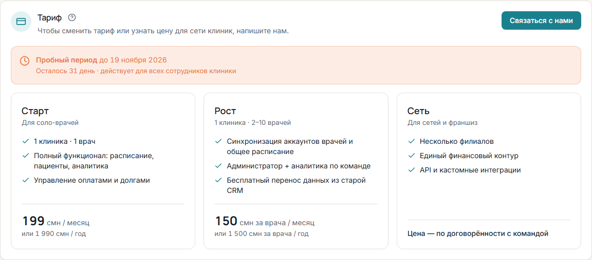

Состояние клиники видно в <kbd>Профиль</kbd> → <kbd>Тариф</kbd>. Лицензия действует для всех сотрудников клиники.

## Пробный период

Новая клиника месяц работает бесплатно. В верхней панели видно «Осталось N дней» и кнопка
<kbd>Связаться с нами</kbd>. В разделе <kbd>Тариф</kbd> — дата окончания: «Пробный период до …».

В программе для Windows пробный месяц начинается, когда компьютер [подключён к серверу](/start/connect-computers/),
и даётся один раз на компьютер: ни переустановка программы, ни новая клиника на том же компьютере его не продлевают.
До подключения программа показывает «Подключите компьютер к серверу», а на компьютере, где пробный месяц уже был
у другой клиники, — «Пробный месяц на этом компьютере уже был у другой клиники».

## Тарифы

| Тариф | Для кого | Цена | Компьютеров |
|---|---|---|---|
| **Старт** | для соло-врачей | 199 смн в месяц или 1 990 смн в год | до 3 |
| **Рост** | 1 клиника, 2–10 врачей | 150 смн за врача в месяц или 1 500 смн за врача в год | до 10 |
| **Сеть** | для сетей и франшиз, несколько филиалов | по договорённости с командой | до 30 |

## Получить и активировать лицензию

Оплата в программе не принимается — лицензию клинике выдаёт команда Klinikon.

1. Свяжитесь с нами: кнопка <kbd>Связаться с нами</kbd> в разделе <kbd>Тариф</kbd> или в верхней панели —
   телефон, Telegram, WhatsApp, Instagram.
2. Когда лицензия выдана, в <kbd>Профиль</kbd> → <kbd>Тариф</kbd> появится сообщение «Вам выдана лицензия «…»»
   со сроком и числом компьютеров.
3. Администратор клиники нажимает <kbd>Активировать</kbd>.

Лицензия, активированная во время пробного периода, начинается после его окончания — оставшиеся
бесплатные дни не пропадают.

## Компьютеры клиники

В разделе <kbd>Тариф</kbd> есть список <kbd>Компьютеры клиники</kbd>: у каждого компьютера отмечено
<kbd>С лицензией</kbd> или <kbd>Без лицензии</kbd>. Лицензия действует на столько компьютеров, сколько в ней указано,
по порядку подключения.

Если компьютер больше не нужен (заменили, продали), нажмите <kbd>Снять с лицензии</kbd> — его место
освободится для другого. Вернуть компьютер можно кнопкой <kbd>Вернуть</kbd>.

## Когда лицензия закончилась

Вместо программы открывается страница <kbd>Нужна лицензия</kbd>. **Данные клиники сохраняются** —
они снова будут доступны, как только лицензия будет активирована.

1. Свяжитесь с нами любым способом со страницы.
2. Мы выдаём клинике лицензию.
3. Администратор клиники нажимает <kbd>Активировать</kbd>, затем <kbd>Обновить статус</kbd>.

На той же странице могут быть и другие подсказки:

- **«Проверьте дату на компьютере»** — часы компьютера отстают. Поставьте правильную дату и время.
- **«Подключитесь к интернету»** — программа больше недели не была на связи с сервером и не может проверить лицензию.
