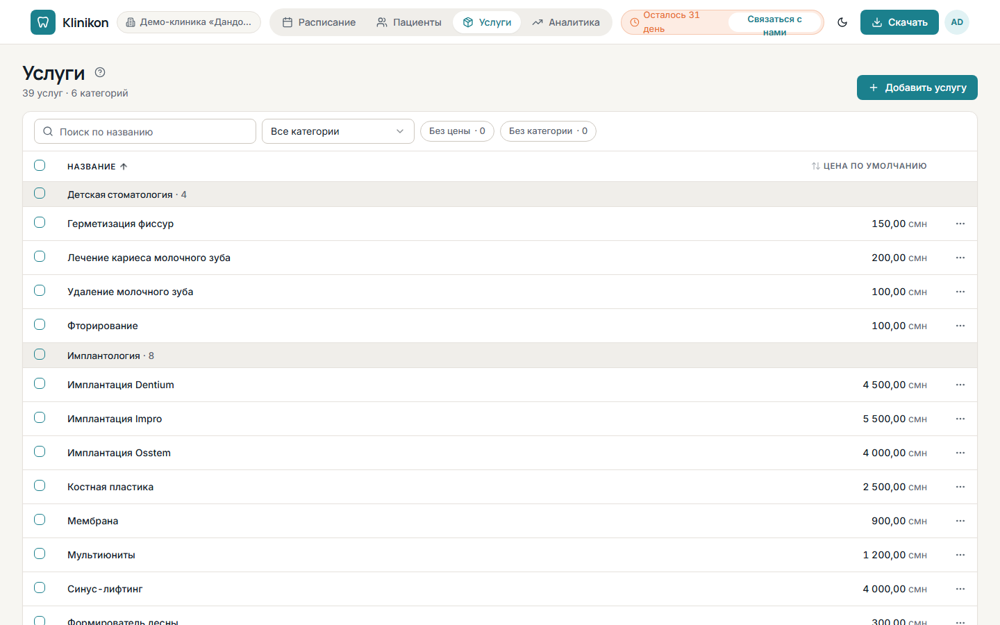

Прайс клиники — страница <kbd>Услуги</kbd> в верхней панели. Из него берутся услуги и цены,
когда врач или регистратура заполняют визит.

## Начать с готового прайса

Если услуг ещё нет, нажмите <kbd>Загрузить стандартный прайс</kbd> — появятся 33 типовые стоматологические
услуги в 5 категориях. Цены потом можно поменять под клинику.

## Добавить услугу

1. Нажмите <kbd>Добавить услугу</kbd>.
2. Укажите <kbd>Название</kbd>.
3. Выберите <kbd>Категорию</kbd> или введите новую и выберите «Создать категорию «…»».
4. Введите <kbd>Цену по умолчанию</kbd> и сохраните.

Цена по умолчанию подставляется в визит, но в самом визите её можно изменить — например, для скидки.

## Найти и поправить

- <kbd>Поиск по названию</kbd> и список <kbd>Все категории</kbd> сужают прайс.
- Кнопки <kbd>Без цены</kbd> и <kbd>Без категории</kbd> показывают услуги, которые ещё нужно дозаполнить.
  Услуга без цены отмечена «Не указана».
- Нажмите на услугу, чтобы изменить её.

Новую услугу можно добавить и прямо из визита: <kbd>Новая услуга</kbd> в разделе <kbd>Услуги и оплата</kbd>.
