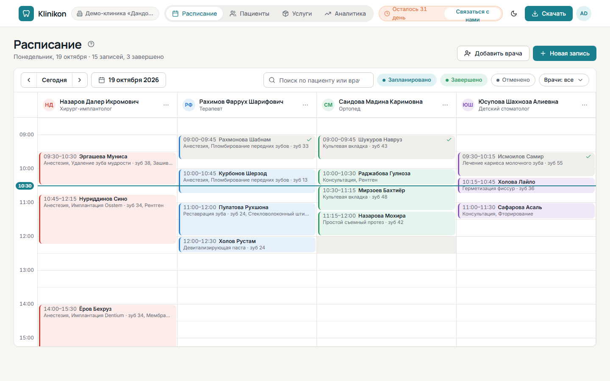

Страница <kbd>Расписание</kbd> открывается первой после входа. Она показывает один день:
по колонке на каждого врача, строки по 30 минут и линию текущего времени.

## Выбрать день

- <kbd>Сегодня</kbd> возвращает к текущему дню.
- Стрелки слева и справа листают дни назад и вперёд.
- Кнопка с датой, например «13 октября 2026», открывает календарь.

Под заголовком страницы видно, сколько записей в этот день, сколько завершено и сколько отменено.

## Записать пациента

1. Нажмите на свободное время в колонке нужного врача или на кнопку <kbd>Новая запись</kbd>.
2. В разделе <kbd>Кто и когда</kbd> выберите пациента (поиск по имени) или нажмите <kbd>Создать пациента</kbd>.
3. Проверьте врача, дату, время начала и окончания.
4. При желании в разделе <kbd>Услуги и оплата</kbd> сразу добавьте услуги и полученную оплату.
5. Нажмите <kbd>Сохранить</kbd>. Появится сообщение «Запись создана».

Если время у врача уже занято, программа предупредит: «Это время уже занято. Выберите другое время.»

## Найти запись

- Поле <kbd>Поиск по пациенту или врачу</kbd> подсвечивает подходящие записи.
- Кнопки <kbd>Запланировано</kbd>, <kbd>Завершено</kbd> и <kbd>Отменено</kbd> показывают или скрывают записи
  с этим статусом. Отменённые по умолчанию скрыты.
- Если врачей несколько, список <kbd>Врачи: все</kbd> оставляет на экране только выбранных.

## Перенести запись

Перетащите запись мышью на другое время или к другому врачу — появится «Запись перемещена».
Чтобы перенести на другой день, откройте запись, нажмите <kbd>Изменить</kbd> и поменяйте <kbd>Дату</kbd>.

## Отменить или удалить запись

1. Нажмите на запись и выберите <kbd>Отменить запись</kbd>.
2. Подтвердите. Запись останется в расписании со статусом <kbd>Отменено</kbd> и освободит время врача.

Отменённую запись можно вернуть кнопкой <kbd>Восстановить</kbd>. Оплата отменённого визита не входит
в долг пациента и в аналитику.

Удалить запись насовсем можно через меню <kbd>⋯</kbd> на записи → <kbd>Удалить</kbd>. Это действие нельзя отменить.

## Статусы записей

| Статус | Что значит |
|---|---|
| <kbd>Запланировано</kbd> | приём ещё впереди |
| <kbd>Завершено</kbd> | время приёма прошло — статус ставится сам |
| <kbd>Отменено</kbd> | запись отменена и не занимает время врача |

## Записи без врача

Если врача удалили, а у него оставались записи, над расписанием появляется блок
<kbd>Записи без врача</kbd>. Нажмите <kbd>Назначить врача</kbd>, чтобы передать запись другому врачу.
