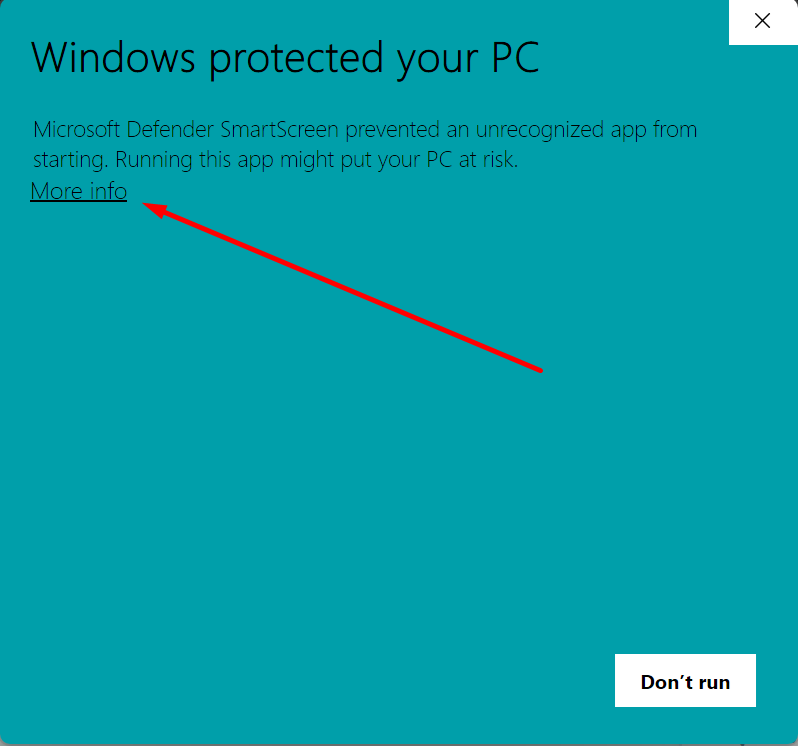
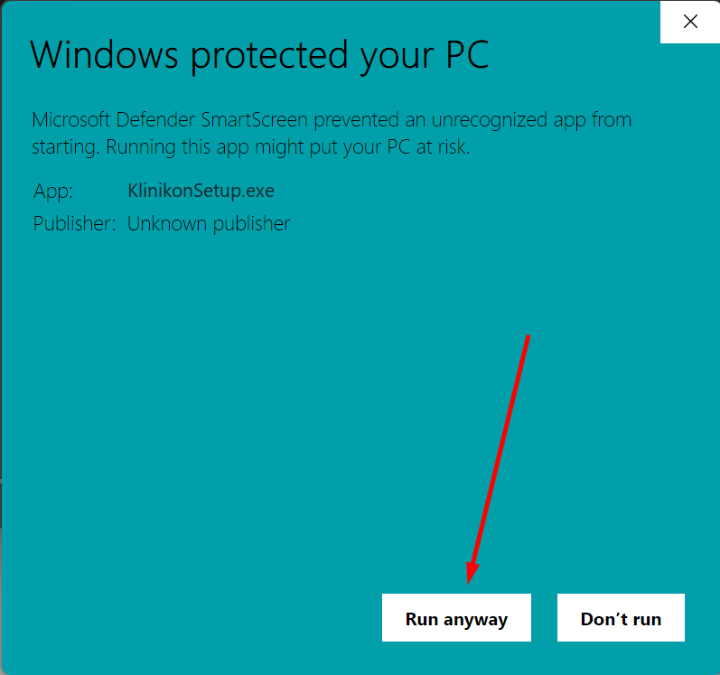

Klinikon работает двумя способами:

- **в браузере** на [klinikon.online](https://klinikon.online) — с любого устройства, ничего устанавливать не нужно;
- **программой для Windows** — работает и без интернета, данные хранятся на компьютере
  и обмениваются с клиникой на сервере, когда связь есть.

Учётная запись и данные клиники в обоих случаях одни и те же.

## Что нужно

- Windows 10 или 11, 64-разрядная.
- Права администратора Windows для установки.
- Microsoft Edge WebView2 — он уже есть в Windows 11 и в обновлённой Windows 10.
  Если его нет, установщик предупредит об этом.

## Скачать

1. Откройте [klinikon.online](https://klinikon.online) и нажмите <kbd>Скачать для Windows</kbd>.
   Если вы уже вошли в веб-версию, та же кнопка есть в верхней панели — <kbd>Скачать</kbd>.
2. В папке «Загрузки» появится файл **KlinikonSetup.zip**.

## Установить

1. Распакуйте **KlinikonSetup.zip** и запустите **KlinikonSetup.exe**.
2. Windows может показать предупреждение «Windows защитила ваш компьютер». Нажмите <kbd>Подробнее</kbd>,
   затем <kbd>Выполнить в любом случае</kbd>.

   

   
3. Пройдите шаги установщика. Значок на рабочем столе по умолчанию не создаётся — отметьте его, если он нужен.
   Пункт **Klinikon** в меню «Пуск» появится в любом случае.
4. На последнем шаге оставьте отметку «Запустить Klinikon» и нажмите <kbd>Завершить</kbd>.

:::note[Почему Windows предупреждает]
У установщика пока нет цифровой подписи, поэтому Windows его не узнаёт. Это безопасно,
если файл скачан с официального сайта klinikon.online.
:::

Программа ставится в `C:\Program Files\Klinikon`. Данные клиники хранятся отдельно, в
`%APPDATA%\Serkor`, поэтому переустановка, обновление и удаление программы их не стирают.

## После установки

Klinikon открывается окном входа. Если у клиники ещё нет учётной записи, начните со статьи
[Первая клиника](/start/first-clinic/). Если клиника уже работает в Klinikon, войдите своим email
и паролем — данные придут с сервера, см. [Подключение компьютеров](/start/connect-computers/).

Пока программа запущена, её значок есть в области уведомлений Windows (рядом с часами).
Меню значка: **Show Klinikon** — открыть окно, **Exit** — закрыть программу.
